# Hi, I'm Pieter 👋

**Aspiring game developer.** I build small games, learn by shipping, and love how databases and systems power what players see.

## 🎮 Game Dev Journey

- Building my first **web game** with HTML, CSS, and JavaScript
- Learning core game dev concepts: game loop, collision, input handling, scoring, and state
- Goal: grow from simple browser games into larger projects with game engines (Godot / Unity)

## 🚀 Other Projects

| Project | What it is | Stack |
|---|---|---|
| **Clinic Appointment & Patient Record System** | Relational schema and SQL implementation | PostgreSQL, SQL |
| **Messaging & Quest Platform Schema** | Conversations, quests, and reviews tables with constraints | Next.js, Prisma |
| **Campus RBAC Design** | Role-based access control matrix and login flow | Security design |
| **x86 ISA Portfolio** | 32-bit assembly milestones | NASM |

## 🛠️ Tech Stack

**Game / Frontend:** HTML5 · CSS3 · JavaScript
**Databases:** PostgreSQL · SQL · Prisma
**Web:** Next.js · TypeScript
**Low-level:** x86 NASM Assembly
**Tools:** Git · GitHub · VS Code

## 📈 Currently

- 🔨 Building: my first web game
- 📚 Learning: JavaScript game loops, CSS animation, sprite handling
- 🎯 Next: add a leaderboard using a database (games + SQL!)

## ✅ How I Work

1. **Prototype fast**: playable first, polished later
2. **Keep it simple**: one mechanic done well
3. **Iterate**: test, tweak, repeat
4. **Ship in milestones**: small, playable updates

## 📫 Connect

- GitHub: [@Froztss](https://github.com/Froztss)
- LinkedIn: [Pieter Jhon Pabilando](https://www.linkedin.com/in/pieter-jhon-pabilando-7362a243b/)
- Email: peterjhon.pabilando@protonmail.com

---

*"Make it playable, make it fun, then make it pretty."* 🎮
